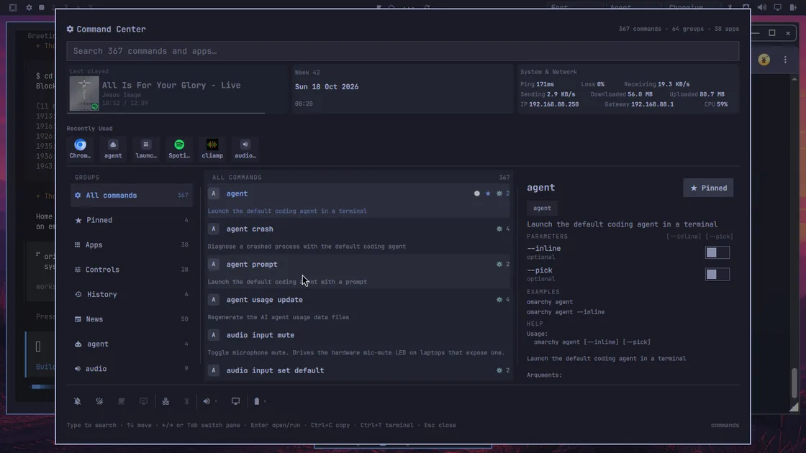
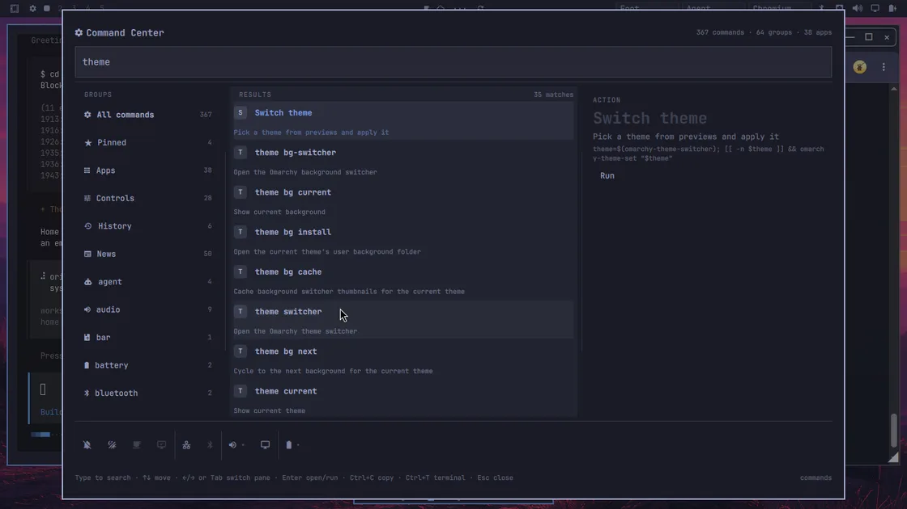
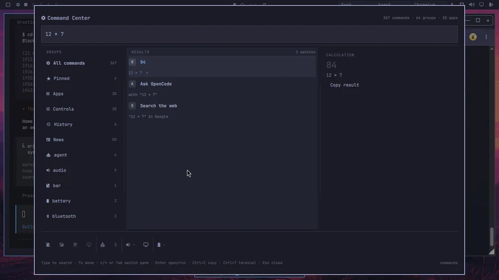
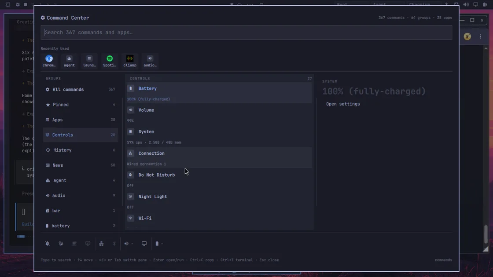
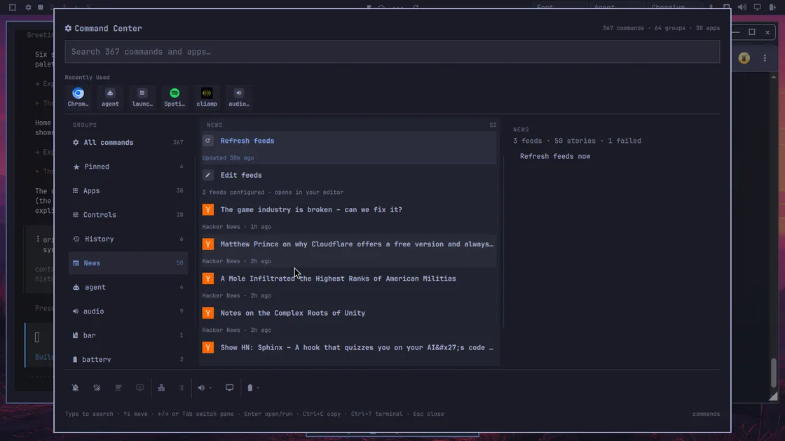
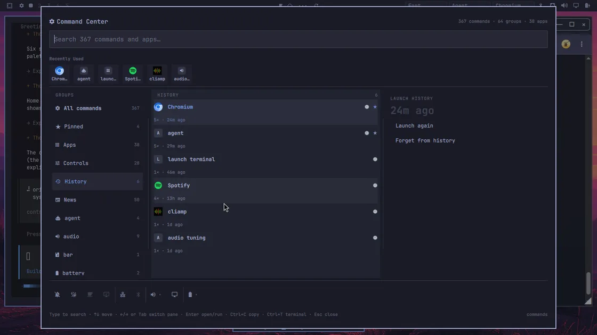

# Command Center



A Raycast-style launcher for [Omarchy](https://omarchy.org) — one palette in
front of every command, app, and system control your desktop exposes.

## Features

- **Search everything** — every omarchy command and installed app (367
  commands and 38 apps on the machine in these screenshots), ranked by usage
  and recency, with app icons throughout.
- **Universal providers** — calculator and unit conversion lead the results,
  with ask-an-agent and web search always one row behind. Window switcher,
  clipboard history, files, and dictionary rows appear as you type.
- **Home** — a fixed, non-shifting block: last played media, the date, and a
  live System & Network tile (ping, packet loss, throughput, IP, gateway,
  CPU) above a Recently Used strip. The dashboard never refreshes on a timer;
  the network tile ticks only while the palette is open. The strip never
  shows one app or command twice, and re-launching promotes it to the front.
- **Groups** — Pinned favorites, Apps with icons, Controls (live status
  readouts plus quick actions with confirmations), History (a launch
  timeline), and News (RSS with feeds you edit in your own editor).
- **Power and session** — sleep, lock, logout, and shutdown from one popover,
  with confirmation on the destructive ones.
- **Super+Space parity** — everything Omarchy's own menu exposes, held in
  place by a test that byte-matches the plugin's action strings against
  `omarchy-menu.jsonc`, so an Omarchy update cannot silently drift it.
- **Bar widget** — a launcher button for the status bar: left click opens the
  palette, right click opens a terminal.

## Screenshots

| Search with the detail pane | Inline calculator |
| --- | --- |
|  |  |

| Controls group | News group |
| --- | --- |
|  |  |

The launch timeline lives in the History group:



## Installation

```
omarchy plugin add https://github.com/AkinleyeMicheal/omarchy-command-center.git --enable --yes
```

Installing with `--enable` also places the bar widget (left click opens the
palette, right click opens a terminal) in the bar's center section. To move
it next to the Omarchy menu instead:

```
omarchy bar move fonsgaudii.cmdcenter --after omarchy.menu
```

## Keybinding

The palette summons through the shell, so any Hyprland binding works. In
`~/.config/hypr/bindings.lua`:

```lua
o.bind("SUPER + SHIFT + K", "Command center", "omarchy-shell shell toggle fonsgaudii.cmdcenter")
```

## Uninstallation

```
omarchy plugin remove fonsgaudii.cmdcenter
```

## Development

```
omarchy plugin validate .
omarchy restart shell
for t in tests/*.test.js; do node "$t"; done
for t in tests/*.test.sh; do bash "$t"; done
```

The suite is 925 assertions across ranking, models, providers, panels, power
actions, news feeds, menu parity, recents, and the URL/destination
security policy. The full build history and
pitfalls log live in [ROADMAP.md](ROADMAP.md). Mutated state stays in
`~/.local/state/omarchy-cmdcenter/`; the plugin never edits
`/usr/share/omarchy/`.

## Network access

- **Weather** (Open-Meteo, your coordinates), **feeds you entered** in
  News → Edit feeds or Add feed (web URLs only), and the optional
  **ask-an-agent** row (the endpoint you configure) — all user-intent
  destinations, honored as entered (LAN/homelab feeds included). A feed
  server's redirect hops are server-chosen, so they must be public or
  return to the host you pasted. Links a pasted page *declares* are
  content and get the guard below; article and search links open only
  as http(s).
- **The News group downloads no feed-supplied images at all** — no
  article heroes, no favicons. Feed rows and cards show the feed's
  initials ("Hacker News" → HN), so feed content can never cause a
  network request beyond the feed XML your own URL points at.
- **Album art** and declared feed links pass a destination guard
  (`fetch-guard.sh`): http(s) only, no userinfo, every resolved address
  must be publicly routable (loopback, RFC1918, link-local/metadata,
  CGNAT, ambiguous octets like `0177.0.0.1`, and every IPv4-embedding
  IPv6 form — v4-mapped, v4-compatible, NAT64, 6to4, Teredo — are
  blocked), redirects are followed manually with the same check
  re-applied at each hop, and the validated addresses are pinned into
  curl (`--resolve`) so a DNS rebind between check and connect cannot
  win. No telemetry.

## Security model

- **Copied data never rides argv.** Clipboard writes (clipboard-history
  entries, copied commands, calc results, titles, paths, definitions)
  go to `wl-copy` over stdin; the file/dictionary queries, the pasted
  feed URL, and the now-playing track metadata use the same stdin
  pattern. Process argv stays world-readable in `/proc`, so private
  payloads never appear there. OSD messages are static text for the
  same reason (control characters stripped, length-capped).
- **Command execution is user intent only.** Terminal launches and
  background runs execute the command line you can see and edit in the
  palette — the equivalent of typing it in a terminal (its text is
  necessarily visible in `ps` while it runs, like any command).
  Remote data and clipboard data provably never reach an execution
  path; `commands.json` is treated as untrusted and only
  `omarchy <subcommand>`-shaped routes survive loading.
- **omarchy's `shell call` dispatcher reaches any root-scope function**
  with one caller-chosen string, so every function on this plugin that
  can execute something or reach the network lives on an internal
  object the dispatcher cannot see (the sanctioned external surface is
  `open`/`close`/`toggle`/`ping`). Object-shaped action handlers
  additionally reject non-object arguments.
- **Image sources are local paths only, gated to `$HOME`.** QML's
  `Image` never fetches URLs; MPRIS-supplied `file://` art, ghost
  snapshot paths, and clipboard image paths are all prefix-checked
  against your home directory (the art copier re-checks and refuses
  symlinks), and `Icon=` values containing path separators are
  rejected.
- **State lives in one owner-only directory**
  (`~/.local/state/omarchy-cmdcenter`, mode 700, files 600); the
  plugin never writes to `/usr/share/omarchy` and removes cleanly with
  `omarchy plugin remove`.

## License

[MIT](LICENSE) (c) 2026 AkinleyeMicheal
